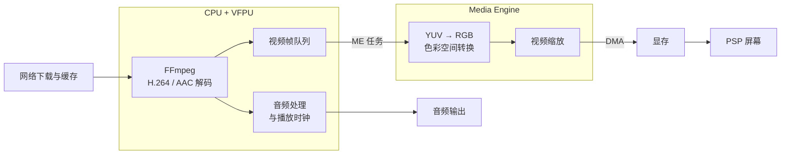
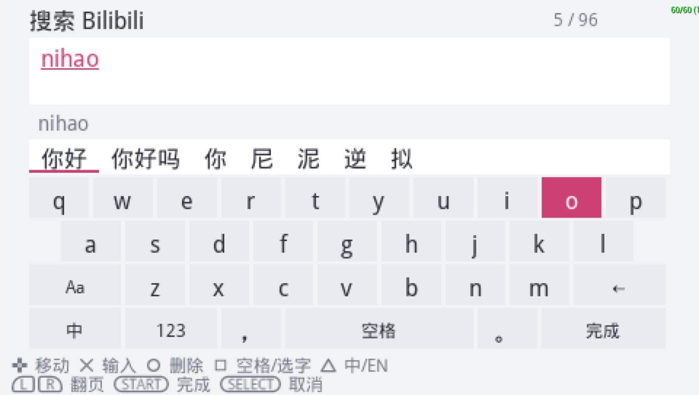
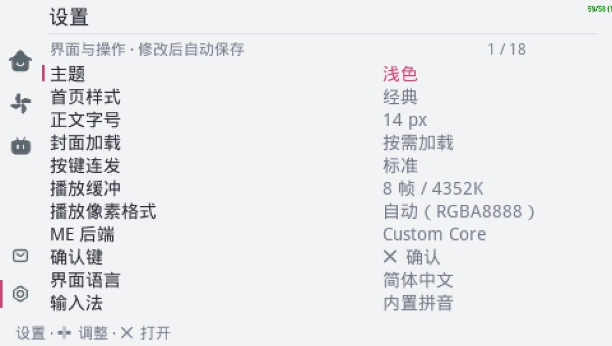
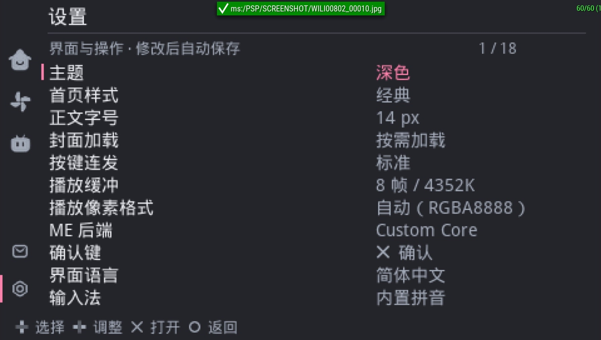
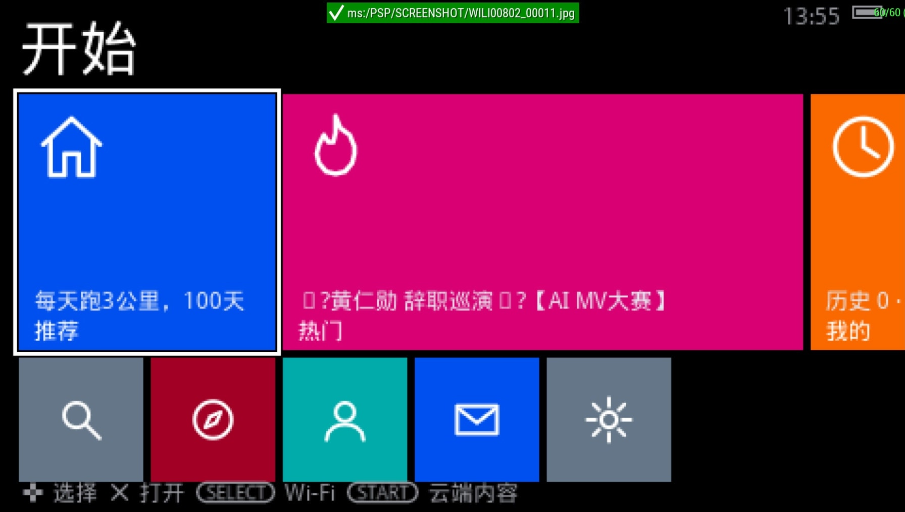
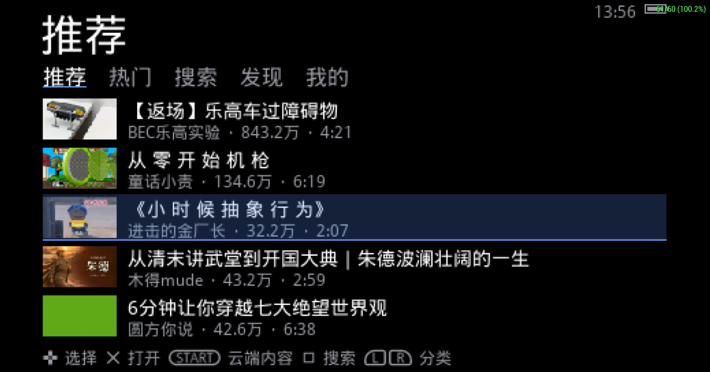
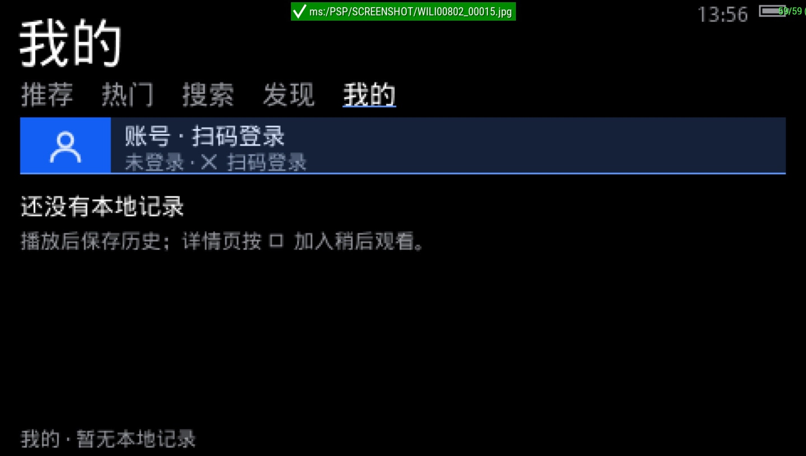
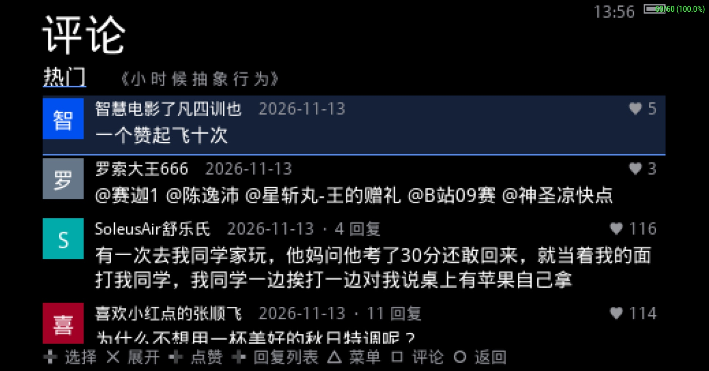

<p align="center">
    
</p>
<h1 align="center">
WiliMini
</h1>
<p align="center">
  一个运行在 Sony PlayStation Portable（PSP）上的第三方
  <a href="https://www.bilibili.com">B站</a> 客户端
</p>
<p align="center">
  <b><a href="#特点">特点</a></b>
  |
  <b><a href="#安装">安装</a></b>
  |
  <b><a href="#文档">文档</a></b>
  |
  <b><a href="#开发">开发</a></b>
</p>

- - -

> 如果喜欢本项目，可以点个免费的 Start 🌟

[](https://github.com/wilimini/WiliMini/releases)
[](LICENSE)


WiliMini 是一个面向 PSP 的原生 Bilibili 客户端。网络请求、界面渲染、视频下载、
音视频解码和显示都在 PSP 本机完成，不依赖外部串流设备。

项目以接近 wiliwili 的浏览体验为目标，并针对 PSP 的内存、带宽和 Media Engine
进行适配。

目前主要在 PSP-3000 + ARK-5 上验证。根据评论区反馈，也支持PSP-1000，PSP-2000，PSP-Go。

||PSP 1000|PSP 2000/PSP 3000/PSP Go|
|---|---|---|
|支持情况|支持|支持|
|颜色编码|RGB565|RGB565/RGBA8888|
|堆大小|12MB|24MB|
|帧缓冲|2|2/4/6/8|


# 新闻

- 2026 年
  - [11/08] v2.8 发布，视频播放时防止屏幕自动休眠变暗；支持通过 PSPLink 的 `btn` 命令注入按键调试
  - [11/08] v2.7 发布，支持应用内在线检查与自动更新，支持 Codeberg/GitHub 双源、断点续传与掉电保护
  - [11/07] v2.6 发布，全面采用 GE 硬件加速绘制整个 UI，封面图片移至工作线程异步解码为 RGB565 纹理
  - [11/05] v2.5 发布，修复音频解码线程等待弹幕线程导致活锁的问题
  - [11/02] 支持连续点击 L/R 按键快进快退，添加中文输入法支持
  - [11/02] 为 PSP-1000 进一步降低内存占用，提供 Metro 和 磁贴 主题
  - [11/01] v2.2 发布，支持 RGB565 像素格式，帧缓存内存占用减半
  - [11/01] v2.1 发布，缓存TLS连接和DNS结果优化网络加载速度并改善日志系统
  - [10/31] v2.0 发布，引入纯 ME Custom Core 依赖，支持 PSP-1000
  - [10/30] v1.2 发布，支持进度条、暂停等功能，支持字幕和弹幕，支持清晰度调节，优化视频播放速度
  - [10/30] v1.1 发布，支持 X/O 切换
  - [10/29] v1.0 发布，支持开启 ME 模拟的 PPSSPP 模拟器
  - [10/28] v0.4 发布，支持 PSP Go 内置储存路径，优化 LR 肩键页面切换逻辑
  - [10/27] v0.1 发布，支持 PSP-3000


# 特点

WiliMini 让 PSP 也可以直接浏览 B站内容：

- **原生运行**：使用 PSP 网络连接，在设备本地渲染和解码
- **内容浏览**：推荐、热门、搜索、动态、用户空间、番剧、影视和收藏
- **视频播放**：支持 360p H.264/AAC，支持 DASH 和 MP4
- **播放体验**：全屏控制栏、画质选择、弹幕、可用字幕轨道、观看历史与播放进度
- **硬件加速渲染**：界面全面由 PSP 图形硬件引擎（GE）批处理绘制，动效流畅不卡顿
- **在线自动更新**：支持在 PSP 检查更新并一键自动升级，支持 GitHub 与 Codeberg 双来源、断点续传与失败回滚
- **内置拼音输入法**：内置轻量全拼输入法，非中文系统固件无需切换系统语言即可便捷进行搜索和发表评论
- **PSP 优化**：使用 VFPU、DMA 和 Media Engine 优化性能
- **模拟器支持**：可以在启用 Media Engine 的 PPSSPP 中运行和验证
- **主题切换**：支持深色与浅色主题，支持经典、磁贴与 Metro 多种主页风格
- **语言选项**：设置页和按键提示支持简体中文与 English
- **全型号支持**：支持 PSP-1000, PSP-2000, PSP-3000, PSP Go

## 性能优化架构

视频播放路径将 CPU 解码和 Media Engine 渲染分工处理，减少主线程等待和显存拷贝：



其中，CPU + VFPU 负责 FFmpeg 解码和音频播放；视频解码后的 YUV 帧进入共享队列，并通过 ME 任务交给 Media Engine。Media Engine 负责色彩空间转换和缩放，处理结果通过 DMA 写入显存。音频播放时钟作为同步基准，CPU 解码与 ME 视频渲染可以并行工作，
减少主 CPU 等待和不必要的显存拷贝。

## 界面截图


<table>
  <tr>
    <td align="center" width="50%"><br>首页推荐（经典浅色）</td>
    <td align="center" width="50%"><br>热门视频（经典浅色）</td>
  </tr>
  <tr>
    <td align="center" width="50%"><br>搜索结果</td>
    <td align="center" width="50%"><br>番剧列表</td>
  </tr>
  <tr>
    <td align="center" width="50%"><br>番剧分集</td>
    <td align="center" width="50%"><br>内置拼音输入法</td>
  </tr>
</table>


<table>
  <tr>
    <td align="center" width="50%"><br>设置（浅色主题）</td>
    <td align="center" width="50%"><br>设置（深色主题）</td>
  </tr>
</table>

磁贴与 Metro 界面

<table>
  <tr>
    <td align="center" width="50%"><br>磁贴主页</td>
    <td align="center" width="50%"><br>Metro 推荐列表</td>
  </tr>
  <tr>
    <td align="center" width="50%"><br>Metro 我的页面</td>
    <td align="center" width="50%"><br>Metro 评论列表</td>
  </tr>
</table>

# 安装

### PSP

1. 从 [GitHub Releases](https://github.com/wilimini/WiliMini/releases/latest) 下载
   `WiliMini-<版本号>.zip`。
2. 解压后，将完整的 `WiliMini/` 目录复制到记忆棒或 PSP Go 内置存储的
   `PSP/GAME/` 目录。
3. 从 PSP 游戏菜单启动 WiliMini。

最终路径应为：

```text
ms0:/PSP/GAME/WiliMini/EBOOT.PBP
```

PSP Go 也可以使用：

```text
ef0:/PSP/GAME/WiliMini/EBOOT.PBP
```

### 在线自动更新（OTA）

完成首次安装后，后续版本升级无需再次拔插记忆棒或连接电脑拷贝：

1. 在客户端进入 **设置** → **检查更新**。
2. 客户端将自动获取最新版本信息。可根据网络状况在 **Codeberg**（推荐国内直连）与 **GitHub** 之间自由选择更新源。
3. 确认后自动进行断点续传下载并校验 SHA-256。
4. 下载完成后提示退出客户端，下次启动时加载器会自动替换安装。

### 从源码构建

构建完成后，将整个 `dist/PSP/GAME/WiliMini/` 目录复制到目标设备的
`PSP/GAME/` 目录。必须启动 `EBOOT.PBP`，不要直接加载客户端 PRX；
加载器会初始化网络模块和 Media Engine bridge。

### PPSSPP

PPSSPP 运行需要支持 Media Engine 执行，并启用 `EmulateMediaEngine`。
使用原生 ME 播放路径时，还需要准备对应机型的 PSP `flash0` 固件目录。
具体配置请参考 [PPSSPP 播放后端](docs/ppsspp-player.md)。

# 文档

- [播放器说明](decoder/README.md)：播放器 API、音视频格式和 Media Engine 生命周期
- [播放控制与弹幕](docs/playback-controls.md)：快捷键、画质菜单、跳转和叠加绘制
- [客户端服务说明](docs/client-services.md)：网络服务和客户端模块
- [界面渲染](docs/ui-rendering.md)：全部由 GE 绘制的精灵批处理、字形图集和页面转场
- [内置拼音输入法](docs/pinyin-ime.md)：独立全拼输入引擎、词库与 UI 交互
- [自动更新与镜像机制](docs/auto-update.md)：OTA 流程、掉电安全原子替换与 Codeberg 同步
- [Custom Core 执行后端](docs/custom-core-backend.md)：适用于全机型（含 PSP-1000）的轻量 ME 执行路径
- [界面文案目录](docs/localization.md)：静态语言表和生成方式
- [PPSSPP 播放后端](docs/ppsspp-player.md)：模拟器构建、固件和播放测试
- [调试指南](docs/debug.md)：PSPLink、USBHostFS 和真机实验流程
- [PSP SELECT 网络问题分析](docs/PSP-SELECT-NETWORK-BUG.md)
- [PSP 解码优化记录](docs/psp-decode-optimization-journey.md)
- [开发与验证工具](tools/README.md)
- [Media Engine 实验](experiments/me/)

# 功能状态

| 模块 | 状态 |
| --- | --- |
| PSP 客户端构建与打包 | 可用 |
| 推荐、热门和搜索 | 已接入 |
| 视频详情、UP 主信息和评论 | 已接入 |
| 番剧、影视和分集列表 | 已接入 |
| 收藏夹、稍后观看和观看历史 | 已接入 |
| 登录和扫码会话 | 已接入 |
| 360p DASH 播放 | 已接入 |
| 渐进式 MP4 自动回退 | 默认关闭，DASH 失败明确提示 |
| 音频播放 | 已接入 |
| 直播播放 | 暂不支持 |
| 续播和退出恢复 | 部分完成 |
| Media Engine 加速 | 实验性 |
| GE 硬件加速 UI 渲染 | 已接入 |
| 内置拼音输入法 | 已接入 |
| 在线自动更新（OTA） | 已接入 |

当前主要针对 360p H.264/AAC 内容进行验证。复杂画面可能出现跳帧或停顿。

# 操作说明

| 按键 | 操作 |
| --- | --- |
| 方向键 | 移动焦点、滚动列表 |
| × / ○ | 确认与返回（默认 × 确认，可在设置中切换） |
| △ | 刷新当前列表 |
| □ | 打开搜索；在详情页切换稍后观看 |
| L / R | 切换主标签页；在详情页打开评论 |
| SELECT | 重新打开 PSP Wi-Fi 设置 |
| START | 首页打开云端内容（我的 / 云端内容）；其他页面同 × 确认 |

播放时 START 暂停/继续，L/R 跳转 10 秒，左右细调并预览进度，△ 选择弹幕、字幕与画质入口，□ 切换弹幕。
详见 [播放控制与弹幕](docs/playback-controls.md)。

设置 → 首页样式 有三种选择（保存为 `settings.json` 的 `home_style`）：

- **经典**：原有的侧边栏首页。
- **磁贴**：磁贴主页（推荐、热门、搜索、发现、动态、消息、我的、设置），子页面使用封面磁贴网格、磁贴式视频详情和强调色选中行。
- **Metro**：与网页设计一致的外观，带状态栏、大号标题、线条图标、枢轴行和带小封面的列表行，选中行为强调色底纹加下划线。

磁贴主页中方向键移动焦点环，确认键进入，返回键从各标签页回到磁贴。磁贴带有翻入、实时磁贴翻面、平滑滚动和启动翻出动画，换页时子页面翻入。

评论页和回复页：↑↓ 在评论间移动，× 原地展开或收起所选评论（长评论在展开后继续 ↑↓ 滚动），← 点赞，→ 打开回复列表，△ 打开操作卡片（回复、点赞、回复列表、更多），□ 发表评论，移到最后一条会自动加载下一页。

搜索页面和评论输入使用屏幕键盘输入文字。PSP 系统键盘只在系统语言为中文时提供中文输入，
因此客户端内置了拼音输入法（设置 → 输入法：内置拼音（默认）/ 系统键盘），
详见 [docs/pinyin-ime.md](docs/pinyin-ime.md)。视频详情页支持评论、收藏、
稍后观看和播放进度操作。

# 开发

## 环境准备

需要安装 PSPSDK 和对应的 PSP 工具链，并设置 `PSPDEV`：

```sh
export PSPDEV=/path/to/pspdev
export PATH="$PSPDEV/bin:$PATH"
```

首次克隆时初始化 Git submodule：

```sh
git clone --recurse-submodules https://github.com/wilimini/WiliMini.git
cd WiliMini
```

已有工作区可以运行：

```sh
git submodule update --init --recursive
```

## 构建依赖和客户端

从仓库根目录使用 Makefile。首次构建需要联网下载固定版本的 FFmpeg 和
libcurl 源码包，构建过程会校验 SHA-256 并自动应用 PSP 补丁。

```sh
make dependencies
make build
make package
```

常用目标：

```sh
make curl          # 只构建 PSP curl
make ffmpeg        # 只构建 PSP FFmpeg
make me            # 构建客户端和 Media Engine 组件
make assets        # 生成字体等资源
```

可以通过 `BUILD_DIR`、`BUILD_TYPE`、`PARALLEL` 和 `CMAKE_ARGS` 调整构建：

```sh
BUILD_TYPE=Release PARALLEL=4 make package
```

默认产物位于：

```text
dist/PSP/GAME/WiliMini/
```

支持两个 ME 执行后端
- Custom Core （默认，PSP-1000可用）
- MIST（PSP-2000以上可用）

详见[播放器说明](decoder/README.md#custom-core-执行后端实验性)。

也可以直接使用 CMake：

```sh
psp-cmake -S . -B build/client
cmake --build build/client --target package --parallel 4
```

如果依赖安装在其他目录，可传入 `PSP_FFMPEG_PREFIX` 和 `PSP_CURL_PREFIX`。

## PPSSPP 回放与主机检查

构建 Headless PPSSPP 并运行客户端：

```sh
sh tools/ppsspp/build-ppsspp-headless.sh
sh tools/ppsspp/run-client-headless.sh
```

内存配置和清理路径的主机检查：

```sh
sh tools/test-memory-profiles.sh
```

PPSSPP 回放可以验证 UI、下载和播放器路径，但不能替代真实 PSP Media Engine
播放验证，也不能据此推断 PSP-1000 或其他固件版本的兼容性。

## PSPLink 真机调试

详细实验要求见 [调试指南](docs/debug.md)。每次变更后先生成完整安装包：

```sh
make package
usbhostfs_pc -vv -b 11000 "$PWD"
```

另开终端连接 PSPLink：

```sh
pspsh -p 11000
```

在 `pspsh` 中使用加载器启动：

```text
cd host0:/
./build/client/loader/bootstrap.prx
```

测试前应复制完整的 `dist/PSP/GAME/WiliMini/` 目录到设备。正常退出客户端后，
再次检查线程是否全部结束；不要把 PSPLink 查询超时直接当作设备崩溃。

# 项目结构

```text
client/       Bilibili 客户端、UI、网络服务和播放控制
decoder/      FFmpeg 播放器、音频、VFPU 和 Media Engine 路径
cmake/        依赖、客户端和打包配置
platform/     PSP 平台集成
scripts/      资源生成和构建清单脚本
tools/        PPSSPP 回放、PSP 辅助工具和主机测试
third_party/  固定版本的第三方依赖
docs/         设计文档、故障分析和研究记录
experiments/  独立实验及其复现资料
results/      PPSSPP、真机和性能实验结果
```

# 反馈问题前

1. 确认 PSP 系统时间和网络设置正确。
2. 确认使用的是完整的 `WiliMini/` 安装目录，而不是源码。
3. 先搜索已有的 [Issues](https://github.com/wilimini/WiliMini/issues) 和讨论。
4. 尽量提供完整复现步骤、设备型号、固件/自制系统版本、日志和截图。
5. 如果是 PPSSPP 问题，请同时提供模拟器版本、机型配置和 Media Engine 设置。

# 贡献

欢迎提交 Issue、改进文档和 Pull Request。

提交代码前请：

- 先确认改动对应的功能或问题，并说明测试环境；
- 保持 PSP 特定代码、平台无关服务逻辑和实验性调优相互隔离；
- 不提交账号 Cookie、扫码登录会话、令牌或私人设备日志；
- 使用 `make package` 验证构建，并在可能时补充 PPSSPP 或真机验证结果。

如果要改进播放器、Media Engine、VFPU 或 DMA 路径，请先阅读
[播放器说明](decoder/README.md) 和相关实验文档，特别注意缓冲区所有权、
缓存一致性、线程退出和固件差异。

# 许可证

WiliMini 采用 GNU General Public License v3 协议开源。第三方依赖及其许可证
见安装包中的 `licenses/` 目录和 [致谢](#致谢)。

# 致谢

感谢以下项目及其贡献者：

| 项目 | 使用内容 | 许可证 |
| --- | --- | --- |
| [FFmpeg](https://ffmpeg.org/) | 音视频解码与容器解析 | LGPL-2.1-or-later |
| [curl](https://curl.se/) | PSP 网络请求 | curl license（MIT-like） |
| [PSP Media Engine MIST](https://github.com/mcidclan/psp-media-engine-mist) | Media Engine 集成 | MIT |
| [PSP Media Engine Custom Core](https://github.com/mcidclan/psp-media-engine-custom-core) | Media Engine core mapper 与辅助库 | MIT |
| [Wiliwili](https://github.com/xfangfang/wiliwili) | Bilibili API/result 代码及界面资源 | GPL-3.0-only |
| [WenQuanYi Micro Hei](https://sourceforge.net/projects/wqy/) | 客户端正文与标题字体 | Apache-2.0 |
| [Source Han Sans](https://github.com/adobe-fonts/source-han-sans) | 音乐播放器歌词字体（Heavy 字重） | OFL-1.1 |
| [rime-ice](https://github.com/iDvel/rime-ice) | 拼音输入法词库 | GPL-3.0-only |
| [nlohmann/json](https://github.com/nlohmann/json) | JSON 解析 | MIT |
| [QR Code generator](https://github.com/nayuki/QR-Code-generator/tree/v1.8.0/c) | 登录二维码生成 | MIT |
| [PSPSDK](https://github.com/pspdev/pspsdk) | PSP SDK 兼容代码 | BSD-3-Clause |
