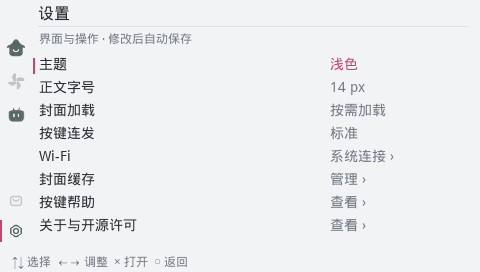
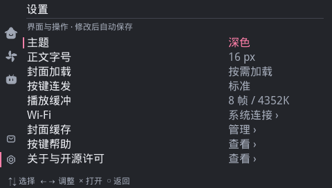

# WiliMini

WiliMini 是一个运行在 Sony PlayStation Portable（PSP）上的第三方 B站 客户端。

它使用 PSP 原生网络访问服务，在设备本地完成页面渲染、视频下载、音视频解码和显示，不依赖外部串流设备。

项目的目标是在 PSP 硬件限制下，提供接近 Wiliwili 风格的 B站 浏览体验，并持续研究 H.264/AAC 解码、VFPU、DMA 和 Media Engine 加速。

> 当前项目处于持续开发阶段，当前版本可以运行。
> 仅在 PSP-3000 + ARK-5 上测试。

# 特点

WiliMini 拥有非常接近 wiliwili 客户端的B站浏览体验

- 原生支持PSP：使用PSP连接网络，本地进行解码，不依赖外部设备串流
- 原速播放视频：
  - 跳过参考帧解码，关闭去块滤波，使用双线性近似运动插值
  - 实现`360p H.264 High`视频原速播放，流畅播放`HE-ACC`音频
- 性能优化：使用主CPU解码、副CPU（ME）渲染，DMA写入显存。帧率相比 `ffplay` 基线提升17.8%
- 功能齐全：推荐、热门、动态、用户、收藏、设置等
- 主题色：拥有深浅两色主题

## 界面截图

<p>
  
  
  
  
  
</p>

## 功能概览

### 内容浏览

- 推荐、热门和搜索
- 视频详情、UP 主信息和投稿列表
- 动态、图文内容和用户空间
- 收藏夹、稍后观看和观看历史
- 番剧、影视和分集列表
- 评论、回复、楼中楼和分页加载
- 消息通知和私信入口

### 播放功能

- 360p H.264/AAC 视频播放
- DASH 视频和音频分离下载
- HTTP Range 按需读取
- 渐进式 MP4 回退
- 视频缓存和观看进度保存
- PSP 原生音频输出
- FLV 直播播放实验

### PSP 特性

- PSP 原生网络连接
- PSP 原生屏幕键盘搜索
- 深色和浅色主题
- 中文点阵字体
- 封面缓存
- VFPU、DMA 和 Media Engine 渲染实验

## 当前状态

| 模块 | 状态 |
| --- | --- |
| PSP 客户端构建 | 可构建 |
| 推荐、热门、搜索 | 已接入 |
| 视频详情和评论 | 已接入，部分线上流程待验证 |
| 360p DASH 播放 | 已接入 |
| 渐进式 MP4 回退 | 已接入 |
| 音频播放 | 已接入，持续验证中 |
| 登录和扫码会话 | 已接入，失效恢复待验证 |
| 番剧和影视页面 | 已接入，播放流程待验证 |
| 直播播放 | 实验性，仍有失败样本 |
| 续播和退出恢复 | 部分完成 |
| Media Engine 加速 | 实验性 |
| PSP-1000 兼容性 | 尚未完成验证 |

详细进度和已知限制见
[当前开发进度](docs/CURRENT-PROGRESS.md)。

## 构建

### 环境准备

需要安装 PSPSDK 和对应的 PSP 工具链，并设置 `PSPDEV`：

```sh
export PSPDEV=/path/to/pspdev
export PATH="$PSPDEV/bin:$PATH"
```

FFmpeg 和两个 Media Engine 源码库作为 Git submodule 固定版本。首次克隆时初始化它们：

```sh
git clone --recurse-submodules <repo-url>
```

如果主仓库已经克隆，则在仓库根目录运行：

```sh
git submodule update --init --recursive
```

客户端依赖 PSP 版本的 FFmpeg、libcurl 和 Media Engine 组件。默认情况下，
CMake 从以下目录查找已构建的依赖：

```text
build/ffmpeg-audio-install/
build/curl-install/
third_party/psp-media-engine-mist/
third_party/psp-media-engine-custom-core/
```

### 构建客户端

推荐使用项目脚本：

```sh
sh scripts/build-client.sh
```

也可以直接使用 CMake：

```sh
psp-cmake -S . -B build/client
cmake --build build/client --target package --parallel 4
```

构建完成后，打包目录为：

```text
dist/PSP/GAME/WiliMini/
```

如果依赖安装在其他目录，可以通过以下 CMake 选项指定：

```sh
psp-cmake -S . -B build/client \
  -DPSP_FFMPEG_PREFIX=/path/to/ffmpeg \
  -DPSP_CURL_PREFIX=/path/to/curl
cmake --build build/client --target package --parallel 4
```

### 安装到 PSP

将 `dist/PSP/GAME/WiliMini/` 整个目录复制到记忆棒的 `PSP/GAME/`，然后从 PSP
游戏菜单启动。

目录中的主要文件包括：

- `EBOOT.PBP`：加载器，负责启动网络模块和 Media Engine bridge。
- `wili_mini.prx`：C++17 客户端，由加载器启动。
- `cacert.pem`：CA 证书集合。
- `cache/`：封面和视频缓存。
- `licenses/`：第三方许可证。
- `build.json`：源文件和产物的 SHA-256 清单。

不要直接加载客户端 PRX。客户端依赖加载器初始化的网络模块和
`me_bridge.prx`。

## 操作说明

| 按键 | 操作 |
| --- | --- |
| 方向键 | 移动焦点、滚动列表 |
| × | 打开详情、播放、确认 |
| ○ | 返回、取消 |
| △ | 刷新当前列表 |
| □ | 打开搜索；在详情页切换稍后观看 |
| L / R | 切换主标签页；在详情页打开评论 |
| SELECT | 重新打开 PSP Wi-Fi 设置 |
| START | 退出客户端 |

搜索页面使用 PSP 原生屏幕键盘输入关键词。视频详情页支持评论、收藏、
稍后观看和播放进度操作。

## 开发调试

通过 PSPLink 调试时，可以使用 USBHostFS 将项目目录映射到 PSP：

```sh
usbhostfs_pc -vv -b 11000 "$PWD"
pspsh -p 11000
```

在 `pspsh` 中启动加载器：

```text
./build/client/loader/bootstrap.prx
```

加载器从 `host0:` 运行客户端时，仍从
`ms0:/PSP/GAME/WiliMini/me_bridge.prx` 加载 Media Engine bridge。

## 项目结构

```text
client/       Bilibili 客户端、UI、网络服务和播放控制
decoder/      FFmpeg 播放器、音频、VFPU 和 Media Engine 路径
scripts/      构建、打包和资源生成脚本
tools/        PPSSPP 回放、PSP 辅助工具和主机测试
third_party/  固定版本的第三方依赖
docs/         设计文档、故障分析和研究记录
experiments/  独立实验及其复现资料
results/      PPSSPP、真机和离线回放结果
```

## 已知限制

- 当前主要针对 360p H.264/AAC 内容进行验证。
- 直播播放目前仍有真实样本失败。
- PSP-1000 与 PSP Slim 的兼容性需要分别验证。

## 相关文档

- [当前开发进度](docs/CURRENT-PROGRESS.md)
- [总体实施计划](PLAN.md)
- [播放器说明](decoder/README.md)
- [PSP select 网络问题分析](docs/PSP-SELECT-NETWORK-BUG.md)
- [UI 设计计划](docs/UI-DESIGN-PLAN.md)
- [UI 待办事项](docs/UI-TODO.md)
- [PSP 解码优化记录](docs/psp-decode-optimization-journey.md)
- [Media Engine 实验](experiments/me/)
- [实验结果](results/)

## 许可证

项目包含 FFmpeg、libcurl、Media Engine 组件和其他第三方代码。构建产物中的
`licenses/` 目录保存随发布包提供的许可证；具体依赖版本、补丁和重链接材料
见 [播放器说明](decoder/README.md) 及 [参考资料锁定文件](docs/references.lock.json)。
