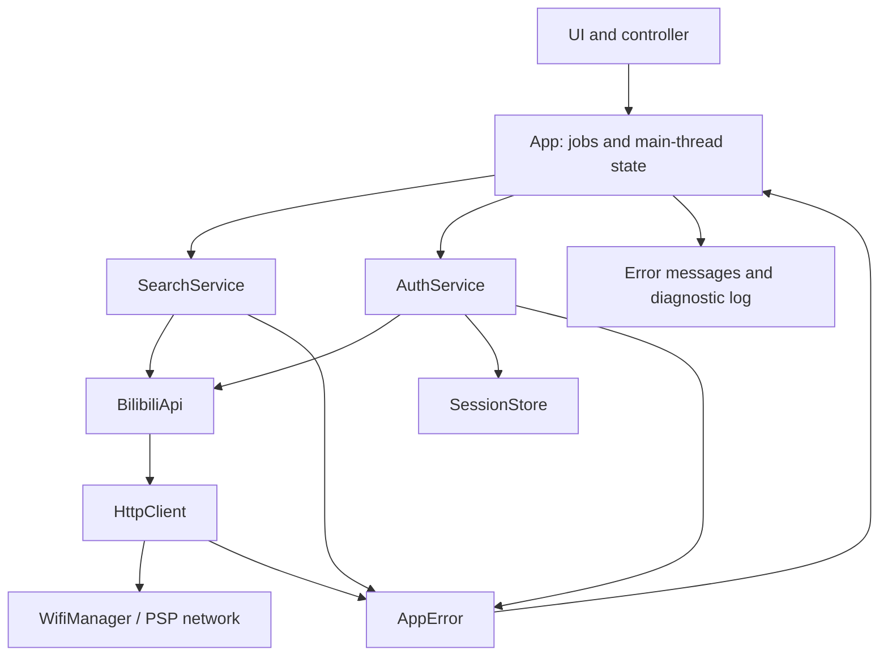

# Client services

Network, search and authentication use typed results. The existing Wiliwili API
entry points remain as an adapter for recommendations, details, comments and
playback URL preparation. Stream workers and decoding retain their existing
lifecycle and are not run through the JSON request transport.

## Ownership and jobs

App owns the API, search and authentication services and the session store.
A single worker runs one job at a time. Its input is captured before starting;
its results are staged until the main thread joins the worker. Renderers read
only main-thread state. Session credentials are applied between requests on this
worker; the synchronous player finishes before another UI job can start.

JSON requests reuse a dedicated curl easy handle with at most two idle
connections. Resetting its request options preserves connection, DNS and TLS
session caches. Request headers, callbacks and POST data are cleared after each
request; curl's persistent cookie engine is not enabled. The handle is destroyed
at network shutdown. Cover and media transfers do not borrow this handle.
Reuse depends on the server keeping the connection open; curl reconnects when
necessary. This does not eliminate the first TLS handshake to a new origin.

DASH video and audio startup overlap: both range threads are started before
either is awaited, so DNS, TCP, TLS and the first response run together and the
30 second size deadline is shared. This relies on the PSP DNS wrapper giving each
lookup its own `hostent` from a small ring guarded by a semaphore (it used to
return one shared static). If either stream fails or is cancelled, both are torn
down together.

All curl handles (API, cover/download and each media thread's private handle)
attach to one `CURLSH` that shares only DNS answers and TLS session tickets, so
later connections can resume a session instead of repeating the full handshake.
Connections and cookies are not shared. A second handle opened at the same moment
as the first cannot resume a session that is still being negotiated, so expect
the gain on reconnects, seeks, backup URLs and repeat visits to a host rather than
on the very first pair of connections. If the share cannot be created, handles
silently fall back to private caches.

The WBI signing key from `/x/web-interface/nav` is kept in memory and in
`wbi-key.txt` next to the other client files, with a one hour lifetime (unchanged)
measured against the device clock. A file that is missing, malformed, expired or
dated in the future is ignored. When the server rejects a signature (`-403`) the
saved copy is deleted before the key is refetched. The key is public nav data, not
a credential.

For timing diagnostics, build with
`CMAKE_ARGS=-DBILI_NETWORK_DIAGNOSTICS=ON make package`.
`HTTP timing` lines contain the request class, status, new connection count and
cumulative DNS/TCP/TLS/first-byte/total times in milliseconds. They omit URLs,
queries, cookies and response bodies. A warm same-origin API request should
normally show `new_connections=0`. DASH timings are emitted when a transfer
ends, including cancellation; total time can include buffer backpressure.
Use identical media, device and build settings for before/after comparisons.

Search requests carry a keyword, page and generation. App rejects results from a
different generation. A failed appended page leaves existing cards and the page
to retry intact. Empty results and cancellation are not errors. Search history
continues using the existing local history file.

## Errors and retries

AppError contains independent domain, kind, operation, raw code and HTTP status.
Result<T> contains a value or an error. UI text is produced by errorMessage;
logs omit raw response bodies, URLs, cookies and QR keys. Playback also uses this
error presentation, while retaining its original stage and cleanup code log.

HttpClient permits one additional attempt for safe GETs on a timeout or HTTP
502/503/504. QR creation and polling do not use automatic transport retries.
WBI keys are cached for one hour. A signature rejection (-403) invalidates the
key and permits one fresh signature attempt. An actual WBI transport failure is
not relabeled as API -412. No operation retries a login-required or risk-control
response indefinitely.

The legacy C network_error buffer remains for stream workers and existing C
callers. New search/auth/API JSON requests return their own response and error.
The old BilibiliClient error callback necessarily flattens these errors when
serving unmigrated UI jobs.

## Login

Open My, select the account row and press Cross. The login page creates a real
Bilibili web QR code and polls every two seconds after the previous poll ends.
States are waiting for scan, waiting for phone confirmation, expired and signed
in. A transport error pauses polling and offers refresh. Circle cancels an
active request and leaves the page once the worker has joined. Leaving the page
stops polling. Triangle refreshes the QR or checks an existing session.

Successful polling reads Set-Cookie from the passport HTTPS response. The store
accepts SESSDATA, bili_jct, DedeUserID and DedeUserID__ckMd5, and requires a
session token and numeric user ID. It persists session.json, then activates the
credentials. The JSON API receives credentials only at exact HTTPS API and
passport hosts, with redirects disabled while credentials are attached. CDN
streams do not receive account cookies. Login response headers are captured
only at the exact passport host, without redirects.

On startup a stored session is restored and checked using nav. A network failure
keeps it intact. Only an explicit logged-out response expires it. Square on the
account page clears local credentials and files; this is local sign-out, not
revocation of all Bilibili sessions. The account's name and UID are shown after
validation. Cloud history/favorites synchronization and automatic cookie-token
refresh are not implemented.

Writes use a temporary file and rename. A backup/rollback path supports memory
sticks that cannot rename over an existing file. Logout also removes temporary
and backup credentials. Errors leave the live session unchanged where possible.
The credentials file is local plaintext; it is not included in build packages.

## Startup feedback and covers

The footer shows the active Wi-Fi connection stage, including address acquisition,
then identifies request preparation, recommendation loading or the popular-feed
fallback. Before networking starts, startup shows local-data loading and network
initialization messages. These messages do not change the connection timeout.

Recommendation, popular, search, detail and browse metadata no longer wait for
cover downloads. The UI shows text and placeholders as soon as metadata commits.
While idle, the existing network worker downloads one cover at a time from a
bounded queue for the visible area. Cached files are skipped and duplicate keys
are queued once. Local history/later pages can also load missing covers.

A new foreground job cancels the current cover and waits asynchronously for that
worker to finish before starting. Curl handles, the resolver, cancellation state
and credentials remain serialized. Navigation and disabling covers discard the
old queue. Playback takes priority over cover work. A failed cover leaves its
placeholder; it is not retried every frame. Refreshing or revisiting the area can
retry it.

Downloads retain the existing temporary-file/rename publication path. Only the
UI thread reads JPEGs into display buffers. Completion invalidates the matching
cover cache key, without replacing cards or clearing other decoded covers.

## Verification

- `python3 tools/test-http-transport.py`: local HTTP/1.1 host check of production
  handle reuse, POST/header reset, cookie isolation, server-close and
  aborted-write recovery.
  Requires a C compiler, Python and `curl-config`; it does not measure PSP TLS.

- `sh scripts/test-services.sh`: production service code with injected transport;
  retry bounds, cancellation, WBI failure/refresh, schema errors, pagination,
  QR states, persistence, session validation, expiry, logout, write failures,
  credential host checks and header bounds, error-log redaction.
- Real account confirmation requires scanning the real PSP login screen with
  the account owner's phone.
- Do not use PSPLink scrshot with the current ME decoder: its partition-4
  scratch allocation overlaps the decoder's ME firmware image. Direct VRAM
  savemem also caused USB transfer stalls. Headless captures do not use either.
