# Home styles

Settings → Home style selects one of three looks. All screenshots are PPSSPP headless captures of
the real client at 480×272 with synthetic sample data (generated covers, a few local records, no
account or network; "服务器请求失败" in the footer is the offline sandbox). Fixtures come from
`tools/ppsspp/seed-ui-fixture.py`. They are emulator results, not PSP hardware captures.

## Classic

| Home | Settings |
| --- | --- |
| 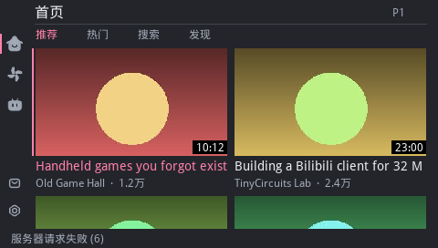 | 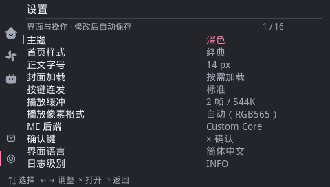 |

## Tiles

Tile home, cover-grid pages, selected rows as accent tiles.

| Tile home | Home | Mine |
| --- | --- | --- |
| 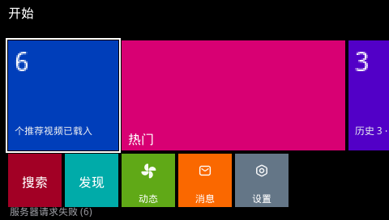 | 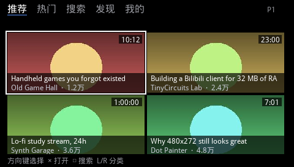 | 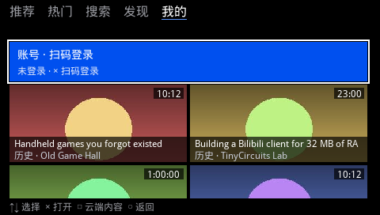 |

| Search | Settings |
| --- | --- |
| 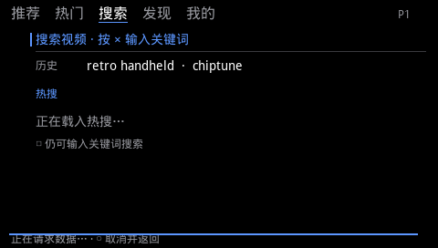 | 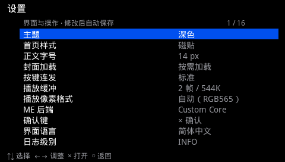 |

## Metro

Status bar, large title, line icons, section row, list rows with a tinted selection.

| Tile home | Home | Mine |
| --- | --- | --- |
| 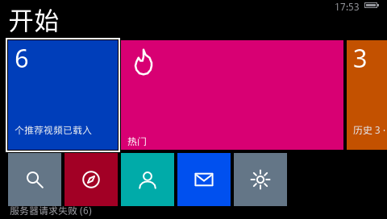 | 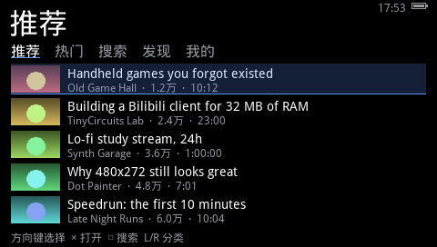 | 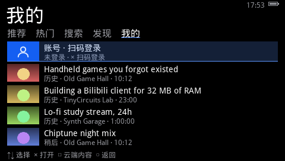 |

| Search | Settings |
| --- | --- |
| 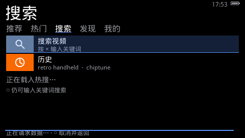 | 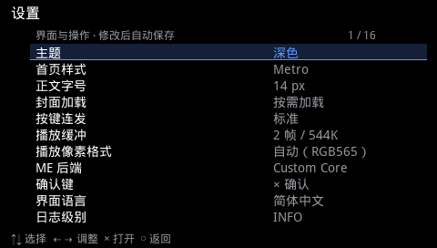 |

Light theme:

| Tile home | Home |
| --- | --- |
| 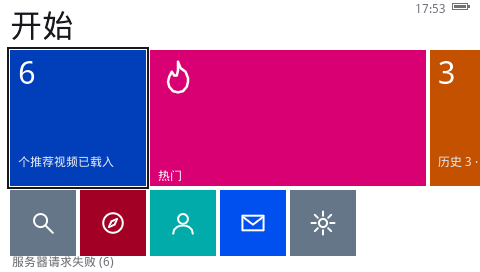 | 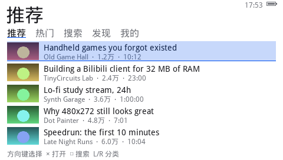 |

## Video lists inside Browse pages

An uploader's videos, favourites, history and watch later use the same list design as Home in each
style. These pages need a signed-in network session, so these images are **host renders** of the
drawing code with the real fonts and flat placeholder covers, not emulator captures.

| Classic | Tiles | Metro |
| --- | --- | --- |
| 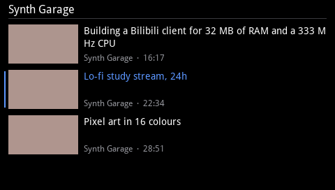 | 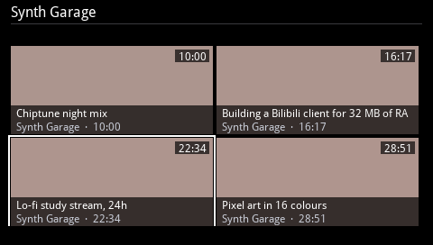 | 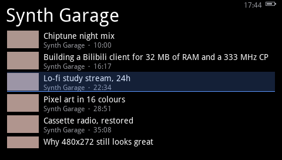 |
