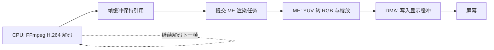
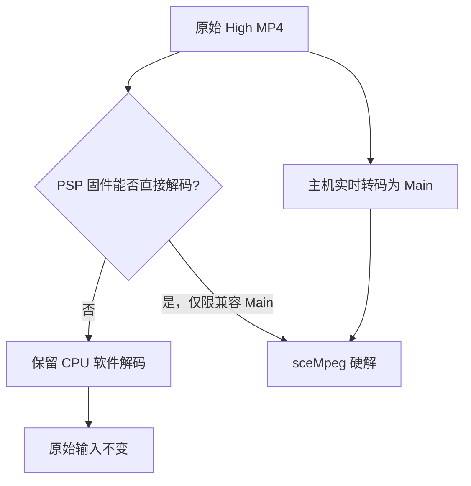
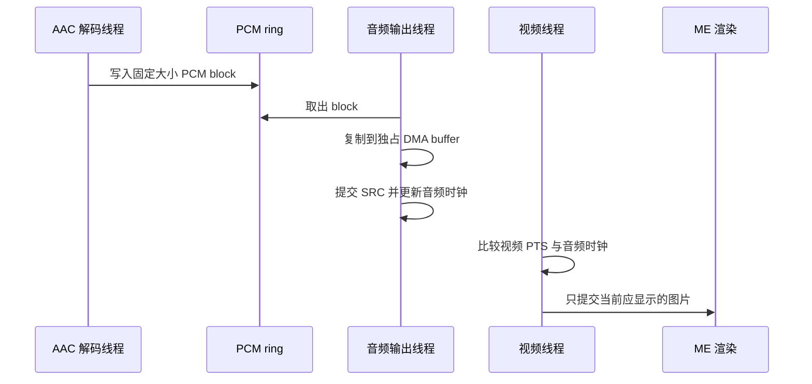
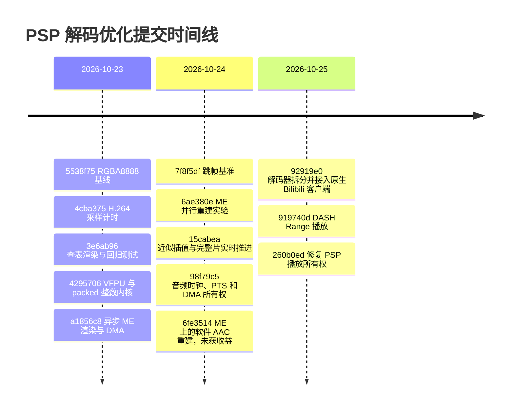

# 在 PSP 上把 H.264 播放推到实时：一条从查表到真机实验的优化路径

这篇文章记录 PSP Bilibili 播放器的 H.264 解码优化过程。时间范围是 2026 年 10 月 22 日至 25 日。数据来自提交历史、PPSSPP 记录和 PSP 真机结果。

结论先说：在保留原始 640×360 High Profile 码流、输出 480×270、不开跳帧的条件下，播放器从约 8.77 FPS 提升到 10.36–10.42 FPS。这个结果仍离 25 FPS 很远。随后我接受了有限的画质和帧率损失，使用双线性近似、关闭去块和跳过非参考帧，让完整视频以 1.00001× 的时间线速度跑到 EOF。加入原速 HE-AAC 后，最终版本以 0.99991× 的速度完成整片播放，4978 个音频块全部提交，没有欠载。

图 1：最终客户端已经可以在 PSP 上访问 Bilibili，并进入播放流程。网络和客户端集成发生在解码优化之后，本文重点讨论解码器和播放时钟。

## 1. 先把问题定义清楚

目标输入是一段 640×360、25 FPS、H.264 High Profile、48 kHz 立体声 HE-AAC 视频。PSP 以 333 MHz CPU 和 166 MHz 总线运行。显示输出缩放到 480×270。

最初的目标是保留原码流和完整画质，并达到 25 FPS。这个目标要求每帧端到端时间低于 40 ms。早期 PPSSPP RGBA8888 基线为 300 帧 19,956.966 ms，也就是 15.03 FPS。它只能帮助验证颜色和计时，不能代表 PSP 真机速度。

真机的第一组可比数据来自 300 帧、30 帧预热的 full render 测试：

| 版本 | 关键配置 | 总耗时 | FPS | 说明 |
| --- | --- | ---: | ---: | --- |
| `run-016/022/026` | 原始标量 C，多次中位数 | — | 8.77 | 真机基线，单次 `run-016` 为 8.84 FPS |
| `run-028` | VFPU 复制 + packed 整数平均 | 32,146.913 ms | 9.33 | 保真局部优化 |
| `run-039` | 异步 ME 渲染 + DMA | 28,793.513 ms | 10.42 | 保真全输出最佳结果 |
| `run-074` | 同上，后续重复基线 | 28,999.074 ms | 10.35 | 用于后续 A/B |
| `run-098` | 近似插值 + 去块关闭 + 跳过帧 + PTS | 210.077992 s / 210.08 s | 1.00001× | 完整视频实时推进 |
| `run-115` | 上述视频路径 + CPU/VFPU HE-AAC | 210.018700 s / 210.00 s | 0.99991× | 完整音视频播放 |

这里要区分三个指标：

1. `FPS` 表示实际显示的图片数。
2. `timeline speed` 表示视频时间线推进速度。
3. `A/V sync` 表示音频时钟和视频 PTS 是否保持一致。

跳过图片后，FPS 会下降，但时间线速度可能达到 1.0×。因此只看 FPS 会误判结果。

## 2. 第一阶段：先优化显示路径

PPSSPP 基线把总耗时分成三块：解码 API 12,454.349 ms，占 62.406%；转换、缩放和显示提交 7,476.390 ms，占 37.463%；读包只占 0.113%。这个结果给出两个方向：先降低显示成本，再测解码内部热点。

第一轮改动集中在 CPU 的 YUV420P 到 RGBA8888 路径：

- 用查表替代每个像素的颜色转换乘法。
- 预计算水平和垂直缩放坐标。
- 以 3 个输出像素为一组复用色度值。
- 用 VFPU 批量复制 16×16 像素块。
- 用 packed 整数运算处理双向预测的像素平均。

VFPU YUV 到 RGB 方案没有变快。它的渲染时间为 4.449–5.314 秒，而查表路径约为 4.08 秒。最终保留的组合是 `VFPU_DSP=4`，也就是 VFPU 复制和 packed 整数平均。

图 2：显示路径优化保留了完整的 480×270 输出。它解决了显示成本，但没有解决 H.264 重建成本。

这一步把真机中位数从 8.77 FPS 提升到 9.33 FPS，约提升 6.44%。解码时间从约 99.88 ms/帧降到 92.97 ms/帧。渲染时间仍约 13.7 ms/帧。

这个结果改变了优化重点：即使把显示时间降到零，93 ms/帧的解码时间也只能得到约 10.7 FPS。继续优化显示不能填补到 25 FPS 的差距。

## 3. 第二阶段：用 Media Engine 隐藏显示工作

PSP 的 Media Engine 可以运行一个独立的 MIPS worker。我先把 YUV 转换、缩放和 RGBA 输出放到 ME，再让 CPU 继续执行 FFmpeg 解码。第一版同步调用很慢，因为 CPU 必须等待 ME 完成。

异步版本改变了工作关系：

要让这条流水线安全，必须处理三个问题：

1. CPU 在 ME 读取期间不能释放 AVFrame。
2. 提交前必须写回输入缓存，ME 完成后必须写回输出缓存。
3. DMA 完成前不能复用输出缓冲。

最终版本用 AVFrame clone 保持引用，用有界等待保护任务，用 DMA 负责显示提交。检查版本比较了 330 张完整图片，ME 与 CPU 输出的差异为 0。最终性能版本提交并完成 330 个任务，正常退出 PSPLink。

`run-032` 和 `run-034` 的 ME 异步渲染加 DMA 结果为 10.3662 和 10.3647 FPS。`run-039` 达到 10.4190 FPS。相对 `run-033` 的 9.3311 FPS，平均提升约 11.09%。

这一步是保真路线的最好结果：解码仍由 CPU 完成，ME 只负责显示相关工作。它证明了显示可以并行，但也证明了 H.264 软件解码才是主要瓶颈。

## 4. 第三阶段：给 H.264 解码插桩，再决定是否搬到 ME

我没有直接猜测 CABAC、运动补偿或去块哪个最慢，而是在 FFmpeg 6.1.2 中加入低扰动采样。每 31 次调用采样一次，预热后清零计数，并把包事件和阶段统计分开保存。

300 帧窗口包含 276,000 个宏块。采样结果显示：

| 阶段 | 调用次数 | 估算总耗时，按采样均值外推 | 观察 |
| --- | ---: | ---: | --- |
| CABAC 宏块入口 | 276,000 | 约 8.37 s | 所有样本为 CABAC |
| 宏块重建 | 276,000 | 约 18.65 s | 包含预测、残差和部分依赖 |
| 运动补偿 | 246,099 | 约 15.05 s | 最大的可拆分候选 |
| 行去块 | 6,900 | 约 6.20 s | 还有边界和缓存准备成本 |
| 帧内预测与残差 | 29,901 | 约 0.78 s | 不能简单丢弃 |

采样值是阶段估计，不是独立总和。它们用于排序候选，不用于替代端到端计时。结果把后续工作集中到运动补偿、预测和缓存所有权。

## 5. 第四阶段：把重建工作并行到 ME，结果却变慢

第一种尝试是把 16×16、16×8、8×16 和 8×8 的预测与残差重建提交给 ME。CPU 同时解析下一个宏块的熵编码。每个异步宏块都必须携带自己的系数、参考像素和缓存边界。

正确性先于性能。检查版本逐宏块比较 CPU 和 ME 的结果，多个版本达到 0 差异。性能却没有提升：

| 运行 | 方案 | FPS | 结果 |
| --- | --- | ---: | --- |
| `run-049` | CPU 解码基线 | 9.1472 | 对照 |
| `run-056` | 已有 ME 渲染 + DMA | 10.3428 | 参考最佳 |
| `run-055` | 延迟预测、共享 ME 队列 | 9.9575 | 变慢 |
| `run-059` | 扩大到多种分区 | 10.0494 | 仍低于参考 |
| `run-065` | 两轴小数插值也交给 ME | 9.7525 | 变慢 |
| `run-068` | 选择性 offload + 内联缓存操作 | 9.8056 | 没有收益 |

原因不是 ME 不能算，而是每个宏块的准备和同步成本太高。ME 还要和显示转换竞争同一个 worker。对一个任务来说，CPU 的 CABAC、参考管理、去块和边界缓存操作仍然存在。把一个局部函数搬到另一个处理器，不等于把整条解码流水线并行化。

批量重建进一步验证了这个判断。`run-081` 把 209,096 个宏块交给 ME，占 67.8%，但平均每个批次只有 6.14 个宏块。`run-083` 加入行范围发布后为 7.2720 FPS，低于 10.3452 FPS 的 ME 渲染参考。批次上限从 8 提高到 40 后，提交次数下降，但 FPS 进一步降到 6.4748。

这条路线最后保留为 opt-in 实验。它通过了大量像素检查，却没有证明全播放器收益。

## 6. 第五阶段：研究 VME 和固件硬解

### VME：算得更快，但搬数据更慢

VME 实验从 8×8 色度插值开始。完整路径必须包含输入扩展、DMA、乘加、结果传输和最终字节写入。最终 16 个 block 的数据如下：

| 路径 | 16 block 中位耗时 |
| --- | ---: |
| CPU FFmpeg C | 111.266 µs |
| 原始 VME full | 334.062 µs |
| VME 本地复制优化 | 202.266 µs |

本地复制方案比原始 VME 路径快约 39%，但仍是 CPU 的 1.82 倍。持久 worker 可以把单 block 的固定桥接成本从约 245 µs 降到约 23.8 µs，但独立的 VME 计算仍落后 CPU。只有在 CPU 同时执行足够多的独立整数工作时，并行才有收益。

结论很明确：VME 微基准通过，不代表播放器加速。它没有进入默认解码路径。

### sceMpeg：原片不能直接交给固件

真机探针确认 PSP 固件可以解码合成的 Main Profile 样本。640×360 控制样本的 `sceMpegAvcDecode` 中位耗时为 5.343 ms，CSC 中位耗时为 1.817 ms。但原始 High Profile 码流首包返回 `0x80628002`，没有得到图像。

原片的关键字段包括 High Profile、6 个参考帧、CABAC、PPS 8×8 变换。实验还统计到前 300 帧的 276,000 个宏块中，有 43,943 个使用 8×8 变换。只改 SPS profile、只清除 PPS 标志或只减少参考帧声明，都不能把原片变成合法的 Main 码流。

把原片在主机端边下载边转码成单参考帧、无 B 帧的 Main Profile 后，PSP 可以边生产边硬解。300 次解码调用全部成功，解码 API 中位耗时为 5.212 ms，CSC 中位耗时为 1.816 ms。但这条链路增加了主机转码，不能作为“PSP 解码原片”的优化结果。

## 7. 第六阶段：部分重建可行，但不够形成播放器

部分 AVC 原型只重建需要的宏块。它保留 CABAC、运动向量和参考列表解析，并用依赖规则补齐帧内预测邻域和参考帧。

结果说明两件事：

- 目标宏块的 43,943 组 YUV 哈希全部匹配。
- 为保证这些目标正确，实际仍需重建 235,007 个宏块，占 85.15%。

保守版本的解码 API 耗时为 88.64 ms/帧。它只验证了目标宏块，不验证完整图像。部分区域仍无效，因此不能播放或编码。

这个实验排除了“只重建 8×8 就能低成本完成”的假设。它没有排除所有压缩域转换方案，但下一步需要重写 slice 熵编码、维护参考图像并处理帧内边界。复杂度已经接近重新实现一套转换器。

## 8. 第七阶段：接受画质和帧率损失，先完成实时播放

保真路线的 10.4 FPS 与 25 FPS 目标相差太大。于是我把目标改成“让视频时间线按原速结束”，并明确记录画质和帧率损失。

最终视频模式使用：

- `SKIP_LOOP_FILTER=48`，关闭去块滤波。
- `SKIP_FRAME=8`，跳过非参考图片。
- `APPROX_QPEL=1`，使用双线性近似运动插值。
- `ME_RENDER=2` 和 `ME_DMA=1`，异步完成颜色转换和显示提交。
- PTS pacing，按视频时间戳控制显示。

为什么只跳过非参考帧？因为这段视频包含参考 B 帧。主机预检显示，跳过所有 B 帧会让 330 帧中的 293 帧发生差异，并产生“reference picture missing”警告。非参考帧跳过则保持匹配。

完整文件结果如下：

| 运行 | 视频时间 | 实际耗时 | 时间线速度 | 保留图片 |
| --- | ---: | ---: | ---: | ---: |
| `run-097`，吞吐模式 | 210.08 s | 193.844557 s | 1.08375× | 2,776 测量帧 |
| `run-098`，PTS 模式 | 210.08 s | 210.077992 s | 1.00001× | 2,776 测量帧 |

`run-098` 证明播放器能按原速推进到 EOF，但它不是 25 FPS 播放。它保留约 13.21 张图片/视频秒，并且 2,806 次显示中有 1,343 次晚于 40 ms，最大延迟 862,771 µs。这个结果的正确表述是“时间线实时，画面降帧且有长尾延迟”。

## 9. 第八阶段：加入音频时钟，修复真正的播放问题

视频按系统时钟推进不够。播放器需要音频作为主时钟，并保护音频 DMA 的内存所有权。

最终音频路径使用 64 个 PCM block，每个 block 有 2048 个立体声采样。音频解码线程负责 FFmpeg 和 PCM ring。输出线程把 block 复制到 4 个独占的 DMA 缓冲，再提交给 `sceAudioSRCOutputBlocking`。视频线程根据已经提交但尚未播放的采样数计算音频时钟，然后按视频 PTS 选择图片。

早期音频实验看起来已经接近 1.0×，但 SRC 返回只表示提交完成，不表示硬件不再读取这块内存。输出线程直接释放 ring slot 后，生产者可能在音频硬件仍在读取时覆盖 PCM。这个 bug 会让声音跳到约 2.73 秒之后，导致音画错位。

增加独占 DMA 缓冲后，`run-114` 通过用户听感确认。最终 `run-115` 完成 210.00 秒视频：

| 指标 | 结果 |
| --- | ---: |
| 音频 block | 4,978 / 4,978 |
| 提交采样 | 10,194,944 / 10,194,944 |
| 音频欠载 | 0 |
| 音频采样率 | 48 kHz，立体声 |
| 视频显示图片 | 2,196 |
| 时间线速度 | 0.99991× |
| 最大音频时钟漂移 | 1.145 ms |

后来又把 AAC 的部分算术重建搬到 ME。118 个独立 PCM 检查全部通过，说明数据正确。但完整播放只有 9.8648 FPS，较 CPU/VFPU 基线 10.3134 FPS 下降 4.35%。ME 同时承担视频颜色转换，音频任务的等待和调度成本抵消了算术卸载收益。这个分支保留为实验，默认播放器继续使用 CPU/VFPU 音频。

## 10. 最终优化结果和取舍

这条探索路径不是“找到一个神奇内核后达到 25 FPS”。它最终得到两套清晰的运行模式：

| 模式 | 输入 | 画质 | 播放结果 | 默认状态 |
| --- | --- | --- | --- | --- |
| 保真模式 | 原始 High H.264/AAC | 完整软件解码，标准重建 | 约 10.3 FPS，不能实时 | 默认解码路径的基线 |
| 实时模式 | 原始 High H.264/AAC | 关闭去块、近似插值、跳过非参考帧 | 视频 1.00001×，音视频 0.99991× | 播放实验配置 |
| 硬解转码模式 | 主机转换后的 Main AVC | 有损转码，依赖主机 | PSP 解码和 CSC 很快 | 独立研究路径 |

最有价值的工程结论有五个：

1. 先用真机端到端计时确定瓶颈。显示优化有收益，但解码仍占主要时间。
2. 异步任务只有在缓存所有权、生命周期和退出路径都明确时才算完成。
3. 正确性测试必须和性能测试分开。逐像素校验会改变调度，不能把校验运行的 FPS 当成性能结果。
4. 单个宏块函数的 offload 不等于完整解码并行化。CABAC、参考帧、帧内邻域、去块和缓存发布必须一起设计。
5. “实时”必须同时报告时间线速度、实际显示图片数、延迟长尾和音频欠载。只报告一个 FPS 会隐藏关键代价。

## 11. 提交历史如何对应这条路线

`92919e0` 之后的网络、客户端和 DASH 提交没有改变上述 H.264 性能结论。它们把已经验证的解码器接入真实 Bilibili 播放，并补齐网络缓冲、取消和媒体所有权。

完整提交脉络如下。提交按功能阶段归类，阶段内仍保持原始时间顺序。

| 阶段 | 提交 | 作用 |
| --- | --- | --- |
| 建立基线 | `e5a5caf`、`e43140e`、`d5898b5` | 初始化工程，固定 FFmpeg 6.1.2 和第三方源码 |
| 测量与渲染 | `5538f75`、`4cba375`、`3e6ab96` | 固定 RGBA8888，加入 H.264 采样和 headless 回归 |
| CPU 优化 | `4295706` | 加入 VFPU 复制、整数 DSP 和 packed 像素平均 |
| ME 显示 | `a1856c8` | 加入异步 Media Engine 渲染、缓存同步和 DMA |
| 解码实验 | `7f8f5df`、`6ae380e` | 测试跳帧和宏块重建并行化 |
| 实时播放 | `15cabea`、`98f79c5` | 接受近似重建，加入 PTS 和音频时钟 |
| ME 音频分支 | `6fe3514` | 验证 AAC 重建可搬到 ME，但性能下降约 4.35% |
| 客户端拆分 | `92919e0`、`21f77db` | 拆出稳定解码器，接入 PSP 网络和真机客户端 |
| 在线播放 | `b2d7620`、`05ef1af`、`a350069`、`1c834fa` | 加入流式读取、RAM ring、可取消 DNS 和 3 GiB 上限 |
| 客户端工程化 | `7533aa0`、`393cc4c`、`e05107b` | 迁移 C++17 和 CMake，修复 API、OSK 与播放回归 |
| DASH 播放 | `919740d`、`260b0ed` | 加入视频和音频 Range 播放，并修复播放所有权 |

`6fe3514` 位于独立的 `codex/me-audio-reconstruction` 分支。它验证了 ME 音频重建的正确性，但没有替换主线的 CPU/VFPU 音频实现。

## 12. 可复核资料

- [VFPU 与显示路径分析](../results/psp-vfpu-full/analysis.md)
- [ME 渲染与 DMA 分析](../results/psp-me-full/analysis.md)
- [ME 并行 H.264 重建分析](../results/psp-me-decode/analysis.md)
- [批量重建流水线分析](../results/psp-me-pipeline/analysis.md)
- [跳帧与近似重建分析](../results/psp-skip-full/analysis.md)
- [音频与 PTS 设计](../experiments/fast-playback/AUDIO.md)
- [VME 数据布局分析](../results/psp-vme/analysis.md)
- [sceMpeg 原片兼容性分析](sce-mpeg-research.md)
- [部分 AVC 重建分析](psp-partial-avc-research.md)

所有结论都绑定到同一份输入文件、PSP 固件和 333/166 MHz 测试条件。更换视频、PSP 型号、固件或网络输入后，需要重新运行 A/B 测试。
