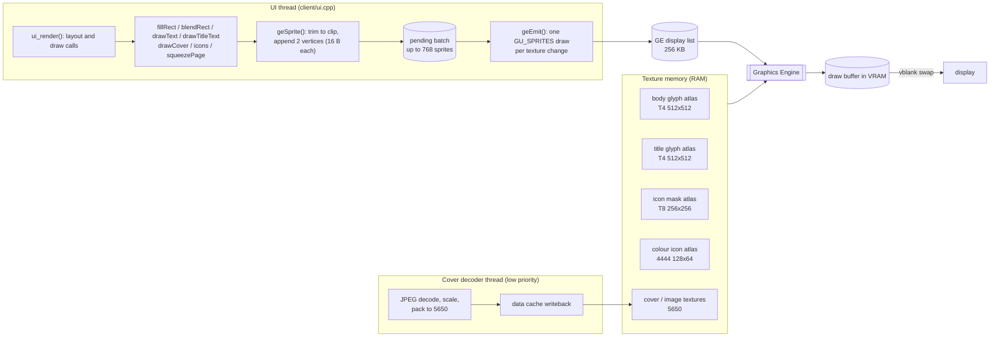
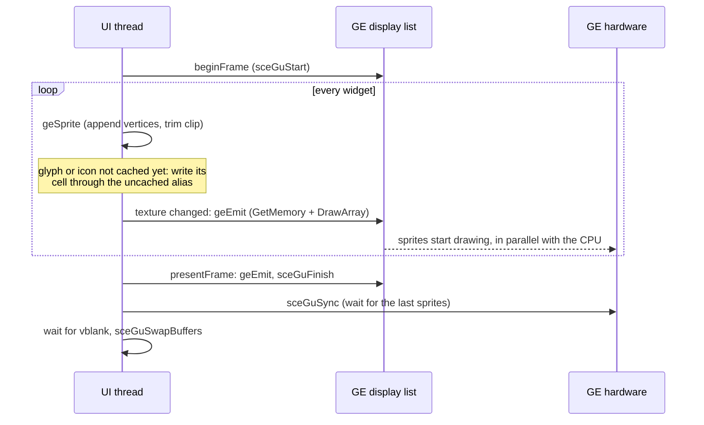

# UI rendering

All of the client UI (`client/ui.cpp`) is drawn by the PSP's graphics engine (GE). The CPU
never writes pixels of the frame, so there is no CPU/GE ordering to get wrong. Earlier
versions drew rectangles, text and icons by writing VRAM from the CPU and only used the GE for
covers, which required the GE to be flushed before every CPU write; that mix caused
cover flicker on hardware.

## Architecture

## One frame

## Why the GE is cheaper than CPU drawing

The old renderer wrote every pixel from the CPU into uncached VRAM. Per frame that was:

| Operation | CPU renderer | GE renderer |
|---|---|---|
| Clear the screen | 130,560 32-bit stores (522 KB) | 1 sprite |
| Text, per glyph | loop over up to 18x20 pixels: unpack a nibble, branch, and for partial coverage **read the pixel back from VRAM**, blend, write it | 1 sprite (32 B of vertices); the GE samples the atlas and blends |
| Cover, per cover | about 25,000 pixels, with integer divisions per pixel for scaling | 1 sprite from a texture half the size (5650) |
| Icons, per pixel | bounds check, VRAM read, blend, write | 1 sprite |
| Translucent rectangles | read-modify-write of every pixel in the area | 1 sprite with alpha |
| Page transition | CPU copies rows within VRAM | GE copy plus 2 scaled sprites |

Reading VRAM from the CPU is uncached and slow on real hardware; the emulator does not
charge for it, so the emulator figures in the pull request understate the gain. After the
change the CPU writes a few kilobytes of vertices per frame instead of several hundred
thousand pixels, the GE draws in parallel with the CPU, and the CPU time freed goes to
decoding and networking.

## Frame flow

`beginFrame()` starts a direct GE list, `ui_render()` draws, and `presentFrame()` ends the
list, waits for the GE, waits for vblank and swaps buffers. Every primitive goes through one
function, `geSprite()`:

- `fillRect`, `blendRect` – solid sprites (blending is always on, an opaque fill has alpha 255).
- `drawText`, `drawBigText` (2x), `drawTitleText` – one sprite per glyph from a glyph atlas.
- `drawCover`, the feed image page – one sprite from a 5650 texture.
- `drawLineIcon`, `drawSidebarIcon`, `drawIconGlyph` – sprites from small icon atlases.
- `squeezePage` – the page flip-in transition (see below).

There is no `framebuffer()` accessor: no code can write the frame from the CPU, and a new
CPU pixel loop would not compile.

## Batching and clipping

`geSprite` appends two 16-byte vertices to a CPU array. When the texture changes (or the
array holds 768 sprites) `geEmit()` sends the batch as one `GU_SPRITES` draw. Because draws
are emitted in call order, painter's-algorithm layering is preserved.

Clipping is done on the CPU by trimming the sprite and its source rectangle, so the scissor
never changes and never splits a batch. Text keeps the old behaviour: it stops at the first
glyph that does not fit `maxWidth` and trims glyph rows to the list's clip rows.

The display list (`commands[]`, 256 KB) also holds the vertex data. If a frame would exceed
it, `geEmit()` ends the list, waits for the GE and restarts it. The measured peak in the
emulator fixtures is about 400 sprites per frame (about 12 KB), far below the budget.

## Atlases

| Atlas | Format | Size | Contents |
|---|---|---|---|
| Body glyphs | T4 + 16-entry CLUT | 512x512, 20x20 cells (625) | 12/14/16 px text, least-recently-used eviction |
| Title glyphs | T4 + CLUT | 512x512 (404 rows used), 36x44 cells (126) | 32 px title font (117 glyphs) |
| Icon masks | T8 + 256-entry CLUT | 256x256 shelves | line icons, sidebar icons as tinted alpha masks |
| Colour icons | 4444 | 128x64 shelves | light-theme sidebar icons |

Glyph bitmaps are already 4-bit coverage, low nibble first, so they map directly onto T4.
The CLUT is white with the index as alpha; the vertex colour supplies the text colour
(`GU_TFX_MODULATE`). Icons are scaled once with the same nearest-neighbour mapping the CPU
renderer used and then drawn 1:1.

Atlas memory is written only through the uncached alias, so the GE sees it without cache
maintenance; stale dirty lines of the block are flushed once at allocation. Cover and image
textures are written through the cache by the decoder thread and written back before use.

**Eviction epochs.** A cell or slot used since the last GE barrier may still be referenced
by queued sprites, so it is not evicted. The epoch advances every frame and every time the
list is restarted. When an atlas has no evictable cell, `geBarrier()` lets the GE finish and
the epoch advances, so the insert always succeeds.

Opaque bitmaps (covers, the frame copy) are sampled with `GU_TCC_RGB`, ignoring the texture's
alpha channel. A copy of the frame buffer carries whatever alpha the GE left there, so using
it made the copied frame invisible; glyphs, masks and 4444 icons use their alpha.

## Page transition

`squeezePage` squeezes the finished frame toward the centre line. It ends the list, has the
GE copy the draw buffer into spare VRAM (past the two frame buffers and the depth buffer),
ends the list again so the copy has completed, fills the background and draws the top and
bottom halves back as two scaled sprites. It runs only during the 200 ms transition. The CPU
never reads VRAM.

## Dialogs

`ui_dialog_frame()`/`ui_dialog_present()` close the list before a PSP system dialog (network
configuration, system keyboard) draws, as those utilities run their own GE work and must not
queue behind an open list. The built-in keyboard draws normal UI and uses `beginFrame()` and
`presentFrame()` instead.

## Memory

The atlases are allocated on first use and freed by `ui_prepare_playback()` (together with
the covers and the feed image) so playback has the memory; the next frame rebuilds them.
About 0.3 MiB in total at peak.

At startup the body font reader loads the existing `wqy.bmf` index in batches.
It stores one offset and advance per glyph, with size and dimensions shared across
contiguous codepoint ranges. The bundled font uses about 445 KiB of heap for this
index. The reader loads glyph pixels from the font file on demand.

## Diagnostics

`-DBILI_UI_FRAME_STATS=ON` logs `UIFRAME` (CPU time of the frame) and `UIGE`: sprites, batches,
list bytes at the last restart, glyph atlas misses, list restarts and GE wait time. PPSSPP times
are counted in emulated instructions; they are a lower bound and say nothing about the GE.

PPSSPP does not model the PSP's data cache. Anything the CPU writes for the GE to read (cover
textures, the CLUTs) must be written back or written uncached; a mistake there looks correct
in the emulator and wrong on a device.
